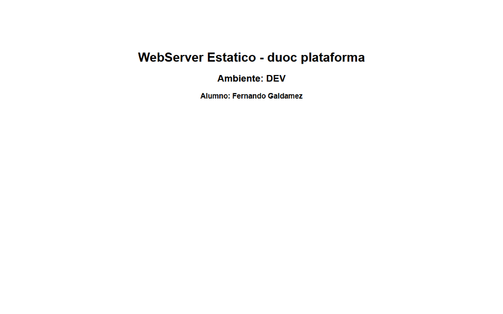
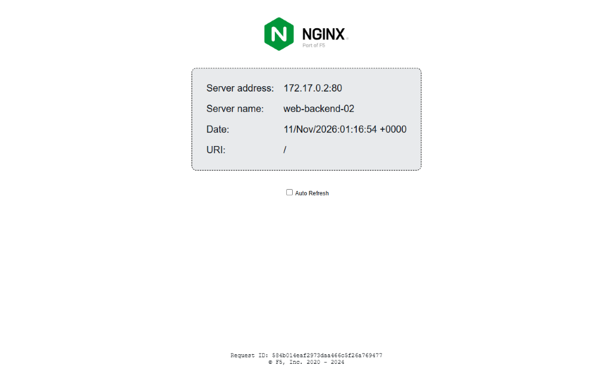
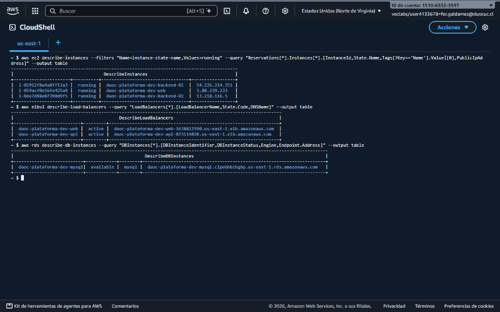
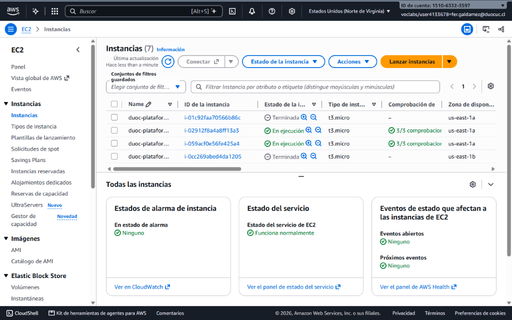
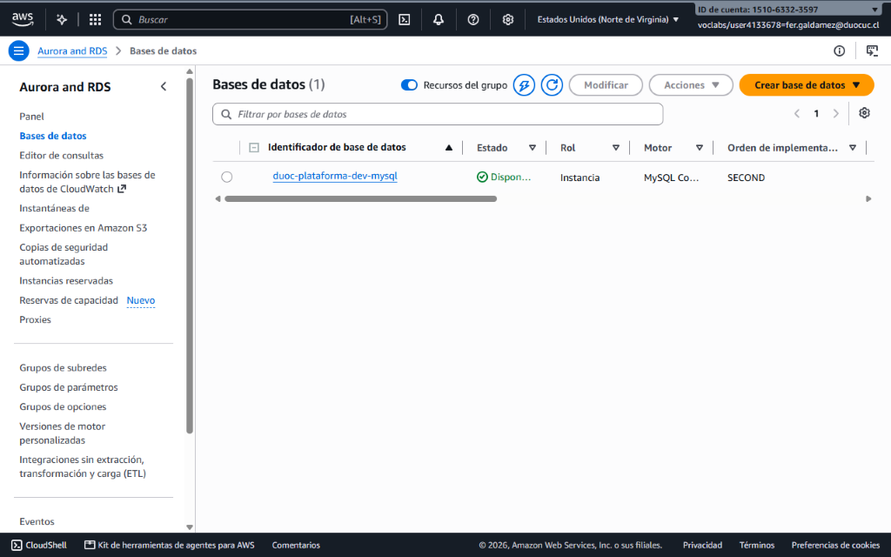
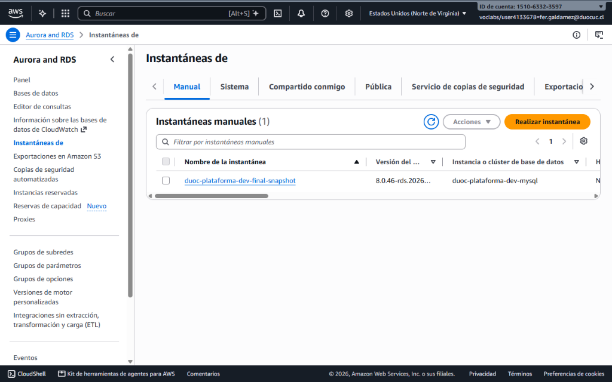

# AUY1103 - Infraestructura como Código I
## Evaluación Parcial N° 3 (EP3) - Parametrización y Evolución de Infraestructura AWS con Terraform

**Integrantes:** Fernando Galdamez | Jose Villaroel (`fer.galdamez@duocuc.cl`)  
**Asignatura:** AUY1103 - Infraestructura como Código I  
**Carrera:** Ingeniería en Infraestructura y Plataformas Tecnológicas  
**Institución:** Duoc UC  
**Fecha:** Noviembre 2026  

---

## 1. Arquitectura General del Sistema

El proyecto evoluciona la solución de la Evaluación Parcial 2 hacia una arquitectura multi-ambiente totalmente parametrizada, desacoplada y orientada a resiliencia bajo Terraform 1.9+. La infraestructura está diseñada para ser desplegada de forma determinista en los ambientes `dev`, `qa` y `prod` en la región `us-east-1` de AWS, respetando los límites y permisos de AWS Academy Learner Lab.

```
                      INTERNET / CLIENTES
                               │
            ┌──────────────────┴──────────────────┐
            ▼                                     ▼
   ┌───────────────────┐                 ┌───────────────────┐
   │  ALB Web Público  │                 │  ALB API Público  │
   │ (${prefijo}-web)  │                 │ (${prefijo}-api)  │
   └────────┬──────────┘                 └────────┬──────────┘
            │                                     │
    Puerto 80 HTTP                        Puerto 80 HTTP
            │                                     │
            ▼                                     ▼
   ┌───────────────────┐                 ┌───────────────────┐
   │  WebServer Nginx  │                 │ Clúster Backends  │
   │  (HTML Estático)  │                 │  (Docker NGINX)   │
   │  [dev: 1 nodo]    │                 │  [dev: 2 nodos]   │
   │                   │                 │  [qa:  3 nodos]   │
   │                   │                 │  [prod: 4 nodos]  │
   └───────────────────┘                 └────────┬──────────┘
                                                  │
                                          Puerto 3306 MySQL
                                                  │
                                                  ▼
                                         ┌───────────────────┐
                                         │  Amazon RDS MySQL │
                                         │ (${prefijo}-mysql)│
                                         │   Schema: appdb   │
                                         │  [dev: Single-AZ] │
                                         │  [prod: Multi-AZ] │
                                         └───────────────────┘
```

### Componentes Principales:
1. **Red Troncal (VPC):** Creada con el módulo oficial `terraform-aws-modules/vpc/aws` versión `~> 6.0`. Soporta topología en 2 o 3 Zonas de Disponibilidad (AZs), derivando dinámicamente subredes públicas, privadas y de datos con funciones de CIDR.
2. **Capa Web Estática:** Instancia EC2 Ubuntu 24.04 con Nginx desplegado mediante `templatefile()`, servida por su propio Application Load Balancer (`${prefijo}-web`).
3. **Capa de Microservicios (Backends Docker):** Clúster de instancias EC2 Ubuntu 24.04 aprovisionadas mediante `for_each` y el módulo local reutilizable `./modules/servidor`. Cada nodo ejecuta un contenedor Docker (`nginxdemos/hello:latest`) y se conecta a un Target Group balanceado por el Application Load Balancer (`${prefijo}-api`).
4. **Capa de Datos (Amazon RDS MySQL 8.0):** Instancia de base de datos relacional MySQL 8.0 protegida con subredes dedicadas, cifrado de almacenamiento KMS (gp3), retención de backups escalable según ambiente y ciclo de snapshots para recuperación de desastres (RPO = 0).
5. **Seguridad Perimetral y Monitoreo:** Security Groups con reglas `dynamic` ingress filtradas según ambiente, habilitación de puerto 22 SSH restringido a la IP pública del operador exclusivamente en `dev`, y un recurso condicional mediante `count` para monitoreo interno en ambientes no productivos.

---

## 2. Convención de Nombres y Etiquetas

Para garantizar consistencia y evitar colisiones de nombres en despliegues concurrentes, se utiliza una convención unificada gobernada en `locals.tf`:

- **Prefijo Global:**
  ```terraform
  local.prefijo = lower(format("%s-%s-%s", 
    replace(trimspace(var.empresa), " ", "-"), 
    replace(trimspace(var.proyecto), " ", "-"), 
    trimspace(var.environment)
  ))
  # Ejemplo: "duoc-plataforma-dev"
  ```
- **Prefijo Truncado (32 caracteres):**  
  AWS impone límites de longitud estrictos en Application Load Balancers, Target Groups e identificadores de RDS (máximo 32 caracteres). Se calcula mediante:
  ```terraform
  local.prefijo_truncado = substr(local.prefijo, 0, 32)
  ```
- **Etiquetado Obligatorio (Default Tags):**
  Todos los recursos integran un mapa de etiquetas estandarizado mediante `merge()`:
  - `Environment`: `upper(var.environment)` (`DEV`, `QA`, `PROD`).
  - `Owner`: `join(", ", [for i in var.integrantes : title(trimspace(i))])` (`Fernando Galdamez, Jose Villaroel`).
  - `Project`: `title(var.proyecto)` (`Plataforma`).
  - `Asignatura`: `"AUY1103"`.
  - `ManagedBy`: `"Terraform"`.

---

## 3. Matriz Completa de Funciones Built-in Utilizadas

A continuación se detalla la totalidad de las funciones nativas de HCL empleadas en el proyecto, indicando el archivo fuente, línea exacta y propósito técnico:

| Categoría | Función | Archivo | Línea | Propósito Técnico en el Proyecto |
| :--- | :--- | :--- | :---: | :--- |
| **Cadenas** | `lower()` | `locals.tf` | 6 | Convierte el prefijo general a minúsculas para cumplir estándares de nombres en AWS. |
| **Cadenas** | `upper()` | `locals.tf` | 14 | Transforma el nombre del ambiente a mayúsculas para la etiqueta `Environment`. |
| **Cadenas** | `title()` | `locals.tf` | 15, 16 | Capitaliza nombres propios de integrantes y proyecto para etiquetas y cabeceras. |
| **Cadenas** | `trimspace()` | `locals.tf` | 6, 15 | Elimina espacios en blanco accidentales en cadenas ingresadas en variables. |
| **Cadenas** | `replace()` | `locals.tf` | 6 | Reemplaza espacios intermedios por guiones para formar slugs válidos. |
| **Cadenas** | `substr()` | `locals.tf` | 9 | Trunca el prefijo a 32 caracteres para identificadores de ALB y Target Groups. |
| **Cadenas** | `format()` | `locals.tf` | 6, 61 | Da formato estructurado a identificadores (`"%s-%s-%s"`) y claves de backend (`"backend-%02d"`). |
| **Cadenas** | `chomp()` | `locals.tf` | 73 | Remueve el salto de línea final de la respuesta IP devuelta por `data.http.mi_ip`. |
| **Colecciones** | `merge()` | `locals.tf` | 12 | Combina etiquetas comunes con etiquetas específicas de cada recurso. |
| **Colecciones** | `lookup()` | `locals.tf` | 51, 54-56 | Consulta valores en la matriz `local.config` suministrando fallbacks obligatorios. |
| **Colecciones** | `keys()` | `locals.tf` | 99 | Extrae las claves del mapa de configuración (`["dev", "qa", "prod"]`). |
| **Colecciones** | `values()` | `locals.tf` | 100 | Obtiene la lista de bloques de configuración de todos los ambientes. |
| **Colecciones** | `length()` | `locals.tf` | 68-70, 105 | Mide dinámicamente la cantidad de subredes, zonas o recursos existentes. |
| **Colecciones** | `slice()` | `locals.tf` | 65 | Selecciona un subconjunto de Zonas de Disponibilidad según `var.cantidad_zonas`. |
| **Colecciones** | `range()` | `locals.tf` | 60, 68-70 | Genera secuencias numéricas para bucles de backends y cálculo de subredes. |
| **Colecciones** | `distinct()` | `locals.tf` | 101 | Elimina posibles valores duplicados en la consolidación de subredes de la VPC. |
| **Colecciones** | `flatten()` | `locals.tf` | 101 | Aplana listas anidadas de subredes públicas, privadas y de datos en una sola lista. |
| **Colecciones** | `toset()` | `main.tf` | 31 | Convierte la lista `["web", "api"]` en conjunto único para instanciar SGs con `for_each`. |
| **Redes (IP)** | `cidrsubnet()` | `locals.tf` | 68, 69, 70 | Calcula dinámicamente bloques `/24` no colisionantes a partir del CIDR maestro `/16`. |
| **Redes (IP)** | `cidrhost()` | `variables.tf` | 42 | Valida en tiempo estático que la variable `vpc_cidr` sea una red IPv4 computable. |
| **Redes (IP)** | `cidrnetmask()` | `variables.tf` | 42 | Comprueba la validez de la máscara de red suministrada en `vpc_cidr`. |
| **Validación / Error** | `can()` | `variables.tf` | 16, 26, 42 | Evalúa si una expresión produce error sin abortar la ejecución del validador. |
| **Validación / Error** | `regex()` | `variables.tf` | 16, 26 | Restringe nombres de empresa y proyecto al patrón alfanumérico con guiones `^[a-z0-9-]+$`. |
| **Validación / Error** | `contains()` | `variables.tf` | 6 | Restringe el ambiente a uno de los tres valores permitidos: `["dev", "qa", "prod"]`. |
| **Validación / Error** | `try()` | `locals.tf` | 73 | Captura excepciones de red al consultar la IP pública y asigna `127.0.0.1` de respaldo. |
| **Validación / Error** | `coalesce()` | `locals.tf` | 73 | Selecciona el primer valor no nulo ni vacío entre la IP remota y la de respaldo. |
| **Conversión** | `tonumber()` | `variables.tf` | 52 | Convierte la cantidad de zonas a número para verificar el rango entre 2 y 3. |
| **Conversión** | `tostring()` | `locals.tf` | 103, 104 | Convierte valores de ambiente y prefijos en cadenas para el objeto JSON de metadata. |
| **Codificación** | `jsonencode()` | `locals.tf` | 102 | Serializa la metadata del despliegue en formato JSON para entrega en `outputs.tf`. |
| **Archivos / Plantillas**| `templatefile()` | `main.tf` | 75, 106 | Renderiza dinámicamente scripts de cloud-init inyectando variables del ambiente. |

---

## 4. Matriz de Comportamiento Condicional por Ambiente

La infraestructura adapta su tamaño, costos, seguridad y persistencia en función de `var.environment`:

| Parámetro / Recurso | Ambiente DEV | Ambiente QA | Ambiente PROD | Justificación Arquitectural |
| :--- | :---: | :---: | :---: | :--- |
| **CIDR de VPC** | `10.10.0.0/16` | `10.20.0.0/16` | `10.30.0.0/16` | Segmentación estricta de red para evitar enrutamiento cruzado accidental. |
| **Zonas de Disponibilidad (AZs)** | 2 AZs | 2 AZs | 3 AZs | Alta disponibilidad geográfica completa en producción. |
| **Subredes Públicas (/24)** | 2 (`10.10.0.0/24`, `10.10.1.0/24`) | 2 (`10.20.0.0/24`, `10.20.1.0/24`) | 3 (`10.30.0.0/24` a `10.30.2.0/24`) | Balanceadores y salida a Internet distribuidos por AZ. |
| **Subredes Privadas (/24)** | 2 (`10.10.10.0/24`, `10.10.11.0/24`) | 2 (`10.20.10.0/24`, `10.20.11.0/24`) | 3 (`10.30.10.0/24` a `10.30.12.0/24`) | Cómputo protegido detrás de NAT Gateway. |
| **Subredes de Datos (/24)** | 2 (`10.10.20.0/24`, `10.10.21.0/24`) | 2 (`10.20.20.0/24`, `10.20.21.0/24`) | 3 (`10.30.20.0/24` a `10.30.22.0/24`) | Capa relacional MySQL aislada sin ruta pública. |
| **NAT Gateway** | Deshabilitado (`0`) | Deshabilitado (`0`) | Habilitado (`Single NAT`) | Minimización de costos en DEV/QA; conectividad privada segura en PROD. |
| **Nodos Backend Docker** | 2 instancias | 3 instancias | 4 instancias | Escalamiento horizontal progresivo para pruebas de carga. |
| **Tipo de Instancia EC2** | `t3.micro` | `t3.micro` | `t3.small` | Validación de rendimiento en producción (`precondition` rechaza micro). |
| **Regla SSH Ingress (Puerto 22)** | Habilitada (IP operador) | Deshabilitada | Deshabilitada | Acceso administrativo restringido exclusivamente al desarrollador. |
| **SG Monitoreo Interno (`count`)** | Creado (`count = 1`) | Creado (`count = 1`) | Omitido (`count = 0`) | Herramientas de diagnóstico internas solo en ambientes no productivos. |
| **RDS Multi-AZ** | `false` | `false` | `true` | Réplica síncrona en producción para tolerancia a fallas de AZ. |
| **Retención Backends RDS** | 1 día | 3 días | 7 días | Ventana de Point-In-Time Recovery adaptada a criticidad del ambiente. |
| **Protección Borrado (`deletion_protection`)** | `false` | `false` | `true` | Evita destrucción accidental de la base de datos de producción vía API. |
| **Snapshot Final al Destruir** | Opcional (`conservar_datos`) | Obligatorio (`true`) | Obligatorio (`true`) | Salvaguarda de datos automática ante destrucción del stack. |

---

## 5. Tabla Comparativa de Planes de Terraform (`plan_*.txt`)

Las diferencias cuantitativas y estructurales de los planes generados antes de cualquier aplicación reflejan con exactitud la matriz de condiciones:

| Métrica del Plan | DEV (`plan_dev.txt`) | QA (`plan_qa.txt`) | PROD (`plan_prod.txt`) |
| :--- | :---: | :---: | :---: |
| **Total Recursos a Agregar (`+`)** | **21 recursos** | **22 recursos** | **26 recursos** |
| **Total Recursos a Modificar (`~`)** | 0 | 0 | 0 |
| **Total Recursos a Destruir (`-`)** | 0 | 0 | 0 |
| **VPC CIDR Planificado** | `10.10.0.0/16` | `10.20.0.0/16` | `10.30.0.0/16` |
| **Cantidad de Subredes Totales** | 6 subredes (2 pub, 2 priv, 2 data) | 6 subredes (2 pub, 2 priv, 2 data) | 9 subredes (3 pub, 3 priv, 3 data) |
| **Instancias EC2 Backends** | 2 (`backend-01`, `backend-02`) | 3 (`backend-01` a `backend-03`) | 4 (`backend-01` a `backend-04`) |
| **Tipo de Instancia Cómputo** | `t3.micro` | `t3.micro` | `t3.small` |
| **NAT Gateways e IPs Elásticas** | 0 | 0 | 1 (`aws_eip` + `aws_nat_gateway`) |
| **RDS Multi-AZ Planificado** | `false` | `false` | `true` |
| **RDS Backup Retention** | 1 día | 3 días | 7 días |
| **RDS Deletion Protection** | `false` | `false` | `true` |
| **Security Group Monitoreo (`count`)** | Presente (`count = 1`) | Presente (`count = 1`) | Ausente (`count = 0`) |

---

## 6. Análisis del Plan de Cambio de Red VPC (`plan_cambio_vpc.txt`)

Al ejecutar una simulación de modificación radical de la red en DEV mediante:
```bash
terraform plan -var-file="dev.tfvars" -var="vpc_cidr=10.99.0.0/16" -var="cantidad_zonas=3" -no-color > plan_cambio_vpc.txt
```
Terraform generó un plan de alto impacto con **14 recursos destruidos y recreados (`-/+`) y 7 recursos modificados in-place (`~`)**:

```
Plan: 16 to add, 7 to change, 14 to destroy.
```

### Detalle de Recursos y Comportamiento del Grafo de Dependencias:

1. **Recursos Destruidos y Recreados (`-/+` Replacement):**
   - **`module.vpc.aws_subnet.public[*]`, `private[*]`, `database[*]`:** El atributo `cidr_block` de las subredes en AWS es inmutable. Si cambia el prefijo base (`10.10.0.0/16` $\to$ `10.99.0.0/16`), AWS exige eliminar las subredes viejas y crear nuevas.
   - **`module.web.aws_instance.this` y `module.backend[*].aws_instance.this`:** Una instancia EC2 no puede migrar en caliente a otra subred con diferente direccionamiento IP privado. Terraform destruye las instancias existentes y aprovisiona nuevas en las subredes `10.99.x.x`.
   - **`aws_db_subnet_group.rds`:** Al asociarse a las subredes de datos que son recreadas, el grupo de subredes de base de datos se reemplaza para enlazar los nuevos identificadores de subred.
   - **`aws_lb_target_group_attachment.*`:** Dado que los IDs de las instancias EC2 cambian tras su reemplazo, los attachments a los balanceadores se recrean.

2. **Recursos Modificados In-Place (`~` In-Place Update):**
   - **`module.vpc.aws_vpc.this[0]`:** AWS permite asociar bloques CIDR adicionales o modificar el CIDR secundario en una VPC sin destruirla inmediatamente.
   - **`aws_security_group.alb[*]`, `monitoreo`, `rds`:** Las reglas que referencian el bloque CIDR de la VPC se actualizan in-place ajustando sus listas de origen.
   - **`aws_lb.web` y `aws_lb.api`:** Los balanceadores de carga soportan la adición o remoción de subredes dinámicamente mediante la llamada a la API `UpdateSubnets` de AWS ELBv2 sin interrumpir el balanceador.
   - **`aws_db_instance.mysql`:** Si la base de datos se mantiene encendida, se actualiza la asociación al nuevo `aws_db_subnet_group` durante la siguiente ventana de mantenimiento o de forma inmediata si se define `apply_immediately = true`.

---

## 7. Diferencias Arquitecturales: `prevent_destroy` vs `deletion_protection`

| Dimensión | `lifecycle { prevent_destroy = true }` | `deletion_protection = true` (AWS RDS / ALB) |
| :--- | :--- | :--- |
| **Capa de Control** | **Cliente / Motor Terraform** (Compilación estática de HCL). | **Proveedor / Nube AWS** (API y Control Plane de AWS). |
| **Mecanismo de Evaluación** | Evaluado localmente antes de ejecutar cualquier plan o apply. | Evaluado por los servidores de AWS al recibir una llamada `DeleteDBInstance`. |
| **Soporte Dinámico / Variables** | **No soporta variables ni condicionales.** Falla de sintaxis en `terraform validate` si no es un literal estático. | **100% dinámico y parametrizable.** Admite expresiones como `local.es_prod ? true : false`. |
| **Protección Fuera de Terraform** | **Nula.** Si un usuario elimina la base desde la Consola Web de AWS o CLI, Terraform no puede impedirlo. | **Total.** Bloquea cualquier intento de borrado provenga de Terraform, AWS Console, SDK o AWS CLI. |
| **Desactivación** | Requiere editar el código `.tf`, eliminar la línea y guardar antes del destroy. | Se desactiva fácilmente mediante una modificación in-place controlada en Terraform (`deletion_protection = false`). |

---

## 8. Módulo Local Reutilizable: `./modules/servidor`

El módulo `./modules/servidor` encapsula las mejores prácticas de aprovisionamiento de instancias EC2 en AWS, evitando duplicación de código entre el servidor web y los backends Docker:

### Parámetros de Entrada (`variables.tf` del módulo):
- `nombre` (string): Nombre lógico y tag de la instancia.
- `ami_id` (string): Identificador de la AMI (Ubuntu 24.04 validado con postcondition `x86_64`).
- `instance_type` (string): Familia de cómputo (`t3.micro` o `t3.small`).
- `vpc_id` (string): Identificador de la VPC para el Security Group asociado.
- `subnet_id` (string): Subred donde se ubica la interfaz ENI.
- `user_data` (string): Script de arranque inyectado en formato cloud-init.
- `asociar_ip_publica` (bool): Habilitación de IP pública para conectividad a repositorios Ubuntu.
- `reglas_ingress` (list(object)): Reglas de entrada dinámicas permitiendo filtrado por SG o CIDR.
- `tamano_disco_gb` (number): Tamaño del disco raíz EBS gp3 cifrado (por defecto 10 GB).
- `perfil_iam` (string): Perfil de instancia opcional para integración SSM.
- `tags` (map(string)): Etiquetas heredadas del entorno.

### Mecanismos de Seguridad Implementados:
- **IMDSv2 Obligatorio:** Se configura `metadata_options { http_tokens = "required" }` para mitigar ataques de Server-Side Request Forgery (SSRF).
- **Inmutabilidad:** Con `user_data_replace_on_change = true`, cualquier modificación al bootstrap provoca el reemplazo limpio de la instancia garantizando infraestructura inmutable.
- **Ciclo de Vida de SG:** Se aplica `create_before_destroy = true` en el Security Group de la instancia para evitar interrupciones de tráfico durante actualizaciones.

---

## 9. Instrucciones de Despliegue y Reproducción

### 1. Inicialización y Validación:
```bash
terraform init -no-color
terraform validate -no-color
```

### 2. Planificación Multi-Ambiente:
```bash
# Desarrollo
terraform plan -var-file="dev.tfvars" -no-color

# Control de Calidad (QA)
terraform plan -var-file="qa.tfvars" -no-color

# Producción
terraform plan -var-file="prod.tfvars" -no-color
```

### 3. Despliegue y Comprobación en Desarrollo:
```bash
terraform apply -var-file="dev.tfvars" -auto-approve -no-color
```

### 4. Verificación de Salidas y Balanceo:
```bash
terraform output -no-color
curl -s -i $(terraform output -raw alb_web_dns)
curl -s -i $(terraform output -raw alb_backend_dns)
```

### 5. Destrucción Limpia:
```bash
terraform destroy -var-file="dev.tfvars" -auto-approve -no-color
```

---

## 10. Evidencias Visuales Reales en Navegador y AWS CloudShell (us-east-1)

### 10.1. Sitio Estático Nginx (ALB Web)


### 10.2. Balanceo de Carga entre Contenedores Docker (ALB Backend API)



### 10.3. Verificación en Vivo desde AWS CloudShell (DescribeInstances, DescribeLoadBalancers, DescribeDBInstances)


### 10.4. Consola de Amazon EC2 y Amazon RDS (Base de Datos e Instantánea Final)



